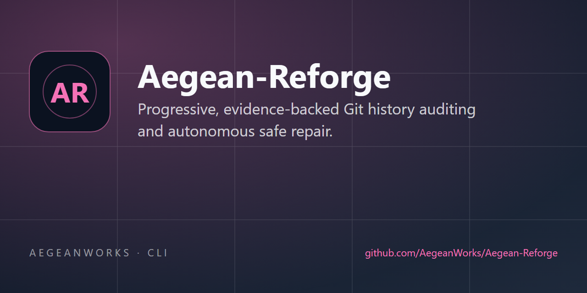

# Aegean Reforge (archived)

> **This repository is archived.** Aegean Reforge is now integrated into
> **[AegeanWorks/AIKit](https://github.com/AegeanWorks/AIKit)**, where `reforge/` and `reforge.py`
> are the only source of truth. Install or clone AIKit to use it:
> `python aikit.py reforge --help` (AIKit project registry) or `python reforge.py --help`.
> This archive keeps the history, tags and issues readable; do not open new pull requests here.

<!-- aegean:media:start -->
<p align="center"></p>
<p align="center"><a href="LICENSE"></a> <a href="https://github.com/AegeanWorks/AIKit"></a></p>
<!-- aegean:media:end -->

> Progressive, evidence-backed Git history auditing and autonomous safe repair.

Aegean Reforge walks a repository's history in independent runs. A run starts at `--start`, grows
by `--step` per stage and stops at `--stop` (defaults 3/3, unlimited): 3, 6, 9, ... or 4, 6, 8, 10.
After a repair is accepted the next stage re-examines the overlap, so a new commit is judged
against the changes already analysed. Runs can be stopped, resumed, reconfigured and started again
later with different settings; each keeps its own history. Each project has its own run lock, so
several projects audit concurrently and a second operation on one project is refused.

## Quick Start

- **Runtime Prerequisites**: Python 3.10+ and `git` (standard library only).
- **Canonical Regression Shield Gate**:

```bash
python -m unittest discover tests
```

## Why It Is Safe

- Findings must carry evidence: the exact commit, path, line and source text.
- Only small, mechanical repairs are automatic (bare `except`, mutable defaults, unsafe
  `yaml.load`, disabled TLS verification, `shell=True` with an argument list).
- Every repair is re-detected, the actual `git diff` is reviewed, and the project's tests run.
  A red gate rolls the patch back before it is recorded.
- Repairs are committed explicitly and pushed without force only when `--push` is passed.

## Commands

```bash
python reforge.py start <repo> --start 3 --step 3 --stop 15  # one independent run
python reforge.py run <repo>              # audit, repair, add regression tests, verify
python reforge.py run <repo> --push       # commit explicit paths, push without force
python reforge.py audit <repo>            # analyse the next window; no edits
python reforge.py fix <repo>              # repair the active run's safe findings
python reforge.py stop <repo> --run run-1
python reforge.py resume <repo> --run run-1
python reforge.py settings <repo> --step 4 --stop 20
python reforge.py runs <repo> --json
python reforge.py status <repo>
python reforge.py report <repo>
python reforge.py repo init [--path <dir>]
python reforge.py repo sync [--direction push|pull] [--force]
```

The audit state lives in `.aikit/reforge.json` and records each independent run: its settings,
stage windows, audited commits, findings, repairs, test results and gate results. A per-project
lock (`.aikit/reforge.run.lock`) prevents a second operation on the same project; different
projects use different locks and states and run concurrently.

<!-- aegean:brand-assets:start -->
## 🎨 Brand Assets

> **AI-Generated Brand Artwork.** The banner and logo are **AI-generated brand assets**. They are illustrative and may not literally depict every feature or the full project scope.
<!-- aegean:brand-assets:end -->

## License

Free for personal use under the Aegean License 1.1 (AL-1.1); see [LICENSE](LICENSE). Commercial
use needs the Aegean Commercial License 1.0 (ACL-1.0); see [COMMERCIAL.md](COMMERCIAL.md).
